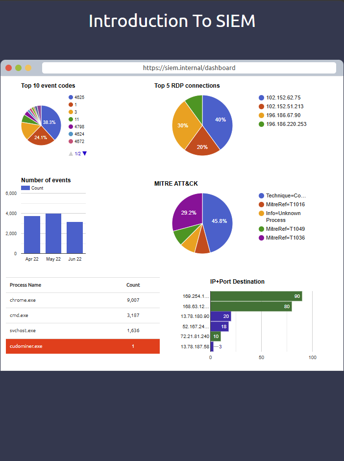
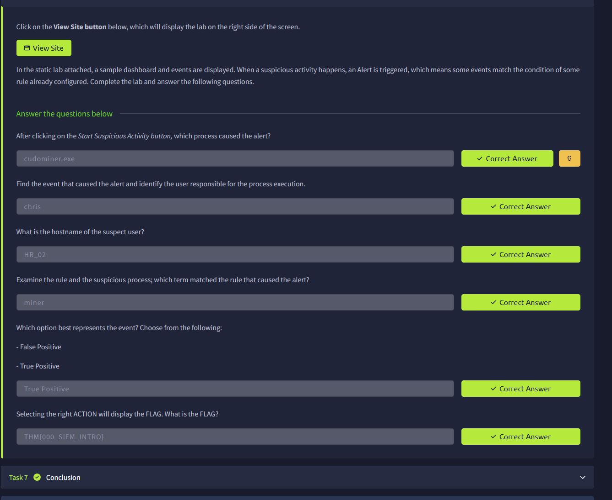
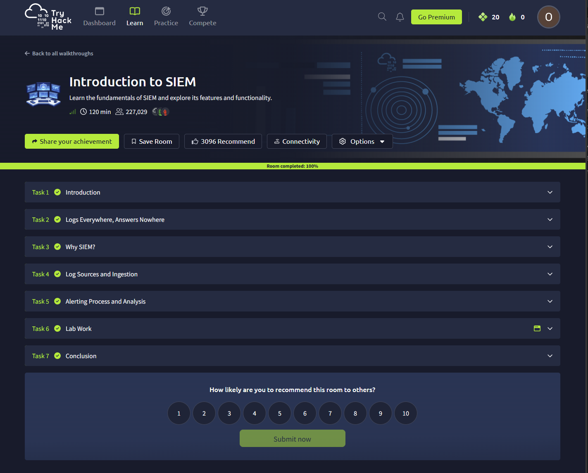

# Investigating a Suspicious Process Using SIEM

**Unit:** ITECH1502 – Cybersecurity Fundamentals  
**Platform:** TryHackMe  
**Exercise:** [Introduction to SIEM](https://tryhackme.com/room/introtosiem)  
**Type of activity:** Guided security monitoring and alert investigation

## Project overview

For this project, I completed TryHackMe's *Introduction to SIEM* room and investigated a suspicious process in its simulated security dashboard. I chose the activity because I wanted to understand what happens after a security system detects something unusual, rather than just learn definitions of SIEM and SOC.

The practical exercise involved an alert linked to a process called `cudominer.exe`. I worked through the available information to identify the associated user and computer, find out why the detection rule was triggered, and decide how the alert should be classified. All six investigation answers were accepted by TryHackMe, and I completed the room's seven tasks.

This is a record of a **training simulation**, not an investigation on a live organisation's network.

## The problem

A security alert tells an analyst that something matched a detection rule, but it does not automatically explain what happened or whether a genuine threat exists. In this exercise I needed to connect several details: the process name, the host, the user and the rule that triggered the alert.

My goal was to make sense of that information and reach a conclusion supported by the exercise.

## What I wanted to learn

- How a SIEM collects and presents information from systems and networks.
- How to investigate a suspicious process rather than relying only on an alert.
- How to identify the relevant user, host and detection-rule match.
- Why an analyst needs to distinguish true positives from false positives.

## How I completed the exercise

1. **Worked through the learning material.** I reviewed the sections on log sources, log ingestion, security alerts and the purpose of a SIEM in a Security Operations Centre (SOC).
2. **Opened Task 6, Lab Work.** I selected **View Site** to launch the sample SIEM dashboard and used **Start Suspicious Activity** to trigger the scenario.
3. **Looked for the unusual process.** The dashboard showed `cudominer.exe` in red, with one recorded occurrence. This made it stand out from the other processes displayed.
4. **Checked the investigation details.** I identified the user as **Chris** and the host as **HR_02**.
5. **Examined why the rule fired.** The detection rule matched the word `miner` in the process name. That explained why the system raised an alert.
6. **Made and checked the decision.** I classified the event as a **true positive** within the scenario. TryHackMe marked all six investigation questions correct.

These were the steps in a guided lab. I did not set up my own SIEM or investigate a real person's device.

## Results and evidence

| Item | Finding |
| --- | --- |
| Suspicious process | `cudominer.exe` |
| User | Chris |
| Hostname | `HR_02` |
| Detection-rule match | `miner` |
| Classification in the lab | True Positive |
| Outcome | Six correct practical answers; room completed 100% |

### 1. Suspicious process on the dashboard

*Figure 1. The sample dashboard after I started the suspicious-activity exercise. The process `cudominer.exe` is highlighted in red.*

### 2. My completed investigation answers

*Figure 2. The six correct answers show the process, user, host, matching rule and the lab's true-positive classification.*

### 3. Proof of completion

*Figure 3. The Introduction to SIEM room at 100% completion.*

I have kept the screenshot verifying my Federation University email with my privately submitted assessment report rather than publishing it here.

## Reflection

### What I learned

The most useful part was seeing how information that looks separate at first can be used together. A process name, a username and a hostname do not mean much on their own, but they start to tell a story when you connect them to an alert.

I also learned that an alert is only a starting point. The word `miner` explained why the rule matched, but in a real workplace I would need more context before concluding that software was unauthorised or harmful. The exercise classified this particular simulated event as a true positive.

### How this relates to my career

I'm still building my practical cybersecurity knowledge, and security operations is an area I want to understand better. This room gave me an introduction to the kind of questions a SOC analyst might ask: what triggered the alert, where did it happen, who was associated with it, and what evidence supports the decision?

It was helpful to do this in a simulation rather than only read about SIEM systems in class.

### What I would do differently

At first, I found it difficult to work out which details were important and how they related to each other. If I repeated the exercise, I would keep a small checklist: record the alert, process, user, host and matching rule before deciding on the classification. I would also take screenshots **while** doing the investigation instead of going back for them afterwards.

If I had access to a more realistic scenario, I would want to check the process origin and related activity before recommending any containment action.

## Ethics and limitations

I used an authorised TryHackMe training environment. In real security work, I would need permission to access the systems and logs involved, protect personal information and be careful not to treat an alert as proof of wrongdoing. This room was useful for learning the basics, but it was a short guided exercise, not a full incident-response investigation.

---

*Portfolio entry for ITECH1502 Cybersecurity Fundamentals, Federation University Australia.*
